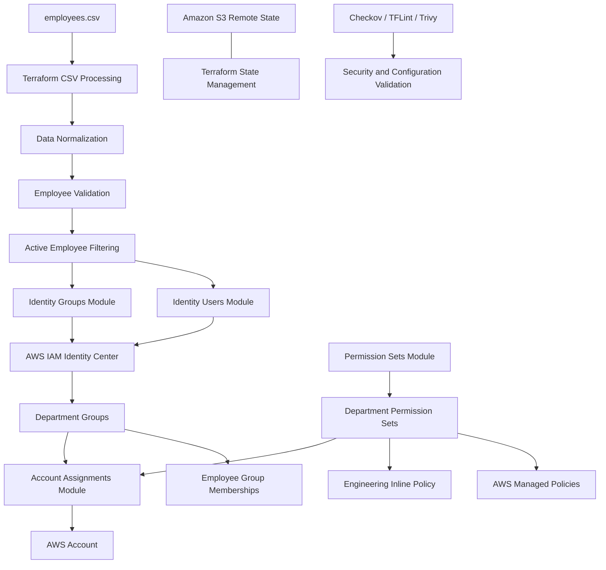

# Enterprise AWS Identity Governance & Access Automation

**Infrastructure as Code | AWS IAM Identity Center | Terraform | AWS Organizations | S3 Remote State**


## 1. Project Overview

The **Enterprise AWS Identity Governance & Access Automation** project demonstrates how employee identities, department-based access groups, permission sets, and AWS account assignments can be managed using Terraform and AWS IAM Identity Center.

The objective is to establish a structured identity governance workflow in which employee information is maintained in a CSV file and Terraform automatically provisions the corresponding identities, groups, memberships, permission sets, and account-level access assignments.

Instead of manually creating users and configuring permissions through the AWS Management Console, this project uses a modular Infrastructure as Code approach to automate identity lifecycle-related provisioning and access management.

The implementation also incorporates employee record validation, department and role restrictions, remote Terraform state management, and infrastructure security scanning.

### Key objectives

- Automate employee identity provisioning.
- Organize employees into department-based groups.
- Implement role-based access using AWS IAM Identity Center permission sets.
- Assign department groups to AWS accounts.
- Validate employee records before provisioning.
- Manage infrastructure through reusable Terraform modules.
- Maintain Terraform state remotely using Amazon S3.
- Introduce security and configuration checks into the development workflow.

---

## 2. Architecture Overview

The project uses AWS IAM Identity Center integrated with an existing AWS Organization.

Employee records are loaded from a CSV file, normalized using Terraform locals, validated against approved departments and roles, and filtered based on employment status.

The resulting employee records are used by Terraform modules to provision identities and configure department-based access.

### Architecture diagram



### Current implementation scope

The current deployment uses one AWS account within the organization.

| Component | Implementation |
|---|---|
| AWS Organization | Existing organization |
| Identity Center | Enabled organization instance |
| Primary region | `us-east-1` |
| Management account | Existing AWS management account |
| Organizational Units | Not created by this implementation |
| Additional member accounts | Not created |
| Employee identities | 7 active users |
| Department groups | 5 |
| Permission sets | 5 |
| Account assignments | 5 |

**Important:** Although AWS Organizations and IAM Identity Center are used, this implementation does not yet automate OU creation or multi-account provisioning. All five department assignments currently target the same management account.

---

## 3. Technologies Used

| Technology | Purpose |
|---|---|
| AWS IAM Identity Center | Centralized identity and access management |
| AWS Organizations | Organization-level account structure |
| Terraform | Infrastructure provisioning and automation |
| Amazon S3 | Remote Terraform state storage |
| Terraform S3 Lockfiles | Remote state locking |
| AWS Identity Store | User and group provisioning |
| AWS SSO Admin API | Permission sets and account assignments |
| CSV | Employee source data |
| JSON | IAM inline policy definition |
| Checkov | Infrastructure security scanning |
| TFLint | Terraform linting |
| Trivy | Infrastructure and configuration scanning |
| AWS CLI | AWS account and service verification |

---

## 4. Project Directory Structure

The project is organized into reusable Terraform modules.

```text
enterprise-identity-governance/
│
├── modules/
│   ├── identity-users/
│   │   ├── main.tf
│   │   ├── variables.tf
│   │   └── outputs.tf
│   │
│   ├── identity-groups/
│   │   ├── main.tf
│   │   ├── variables.tf
│   │   └── outputs.tf
│   │
│   ├── permission-sets/
│   │   ├── main.tf
│   │   ├── variables.tf
│   │   └── outputs.tf
│   │
│   └── account-assignments/
│       ├── main.tf
│       ├── variables.tf
│       └── outputs.tf
│
├── policies/
│   └── engineering-policy.json
│
├── tests/
│
├── employees.csv
├── backend.tf
├── provider.tf
├── versions.tf
├── variables.tf
├── locals.tf
├── main.tf
├── outputs.tf
├── dev.tfvars
├── .gitignore
├── .tflint.hcl
└── README.md
```

### Module responsibilities

| Module | Responsibility |
|---|---|
| `identity-users` | Creates employee identities in IAM Identity Center |
| `identity-groups` | Creates department groups and employee memberships |
| `permission-sets` | Creates department permission sets and attaches policies |
| `account-assignments` | Assigns department groups to AWS accounts |

Each module has its own `main.tf`, `variables.tf`, and `outputs.tf` to maintain separation of responsibilities and improve reusability.

---

## 5. Employee Data Management

Employee information is maintained in `employees.csv`.

Example:

```csv
employee_id,first_name,last_name,email,department,role,employment_status
EMP001,Michael,Scott,michael@company.com,Education,MANAGER,ACTIVE
EMP002,Dwight,Schrute,dwight@company.com,Sales,ANALYST,ACTIVE
EMP003,Jim,Halpert,jim@company.com,Sales,ANALYST,ACTIVE
EMP004,Pam,Beesly,pam@company.com,HR,HR_SPECIALIST,ACTIVE
EMP005,Stanley,Hudson,stanley@company.com,Finance,ANALYST,ACTIVE
EMP006,David,Wallace,david@company.com,Finance,FINANCE_MANAGER,ACTIVE
EMP007,Ryan,Howard,ryan@company.com,Engineering,DEVELOPER,ACTIVE
EMP008,Kelly,Kapoor,kelly@company.com,Sales,ANALYST,INACTIVE
```

*The employee records above are fictional examples used for demonstration.*

### Data normalization

Terraform's `csvdecode()` function reads the employee CSV file.

The `locals.tf` configuration normalizes employee information:

- Removes unnecessary whitespace.
- Converts email addresses to lowercase.
- Normalizes department names to lowercase.
- Normalizes role names to uppercase.
- Normalizes employment status.

### Employee validation

The project validates employee records against approved departments and roles.

Approved departments:

- Engineering
- Finance
- HR
- Sales
- Education
- Operations

Approved roles:

- MANAGER
- ANALYST
- HR_SPECIALIST
- FINANCE_MANAGER
- DEVELOPER

Employee records are checked for required fields, email format, approved departments, approved roles, and valid employment statuses.

Invalid records are exposed through Terraform outputs, and a `terraform_data` validation resource blocks user provisioning when invalid employee records are detected.

### Active employee filtering

Only employees with the employment status `ACTIVE` are passed into the user and group provisioning modules.

In the sample dataset:

- Total employee records: 8
- Active employees: 7
- Inactive employees: 1

The inactive employee is excluded from the current provisioning operation.

---

## 6. IAM Identity Center User Provisioning

The `identity-users` module provisions employee identities using:

`aws_identitystore_user`

Each employee is provisioned with:

- Employee email as the username.
- First and last name.
- Display name.
- Primary work email address.

Terraform uses `for_each` to create user resources dynamically from the active employee map.

The module also includes a validation dependency to prevent user provisioning when invalid employee records are detected.

---

## 7. Department Group Management

The `identity-groups` module creates department-specific groups using:

`aws_identitystore_group`

The current implementation provisions five groups:

| Department | Group name |
|---|---|
| Engineering | Engineering-Users |
| Finance | Finance-Users |
| HR | Hr-Users |
| Sales | Sales-Users |
| Education | Education-Users |

Employee memberships are managed using:

`aws_identitystore_group_membership`

Each active employee is assigned to the group associated with their department.

This creates a structured relationship between employee identities and department-based access groups.

---

## 8. Permission Set Management

The `permission-sets` module creates AWS IAM Identity Center permission sets using:

`aws_ssoadmin_permission_set`

Each permission set defines the access profile assigned to a department.

### Permission set configuration

| Department | Permission set | Access configuration |
|---|---|---|
| Engineering | Engineering-Developer | Custom inline policy |
| Finance | Finance-ReadOnly | AWS ReadOnlyAccess |
| HR | HR-ReadOnly | AWS ReadOnlyAccess |
| Sales | Sales-ReadOnly | AWS ReadOnlyAccess |
| Education | Education-ReadOnly | AWS ReadOnlyAccess |

### Session duration

All permission sets use:

```hcl
session_duration = "PT1H"
```

This configures a one-hour maximum AWS access session.

### AWS managed policy attachments

The project attaches the AWS managed policy:

```text
arn:aws:iam::aws:policy/ReadOnlyAccess
```

This is applied to the Finance, HR, Sales, and Education permission sets.

**Security consideration:** AWS ReadOnlyAccess provides broad read-only permissions across many AWS services. It does not provide strict department-level resource isolation. Production environments should use more narrowly scoped policies based on actual departmental requirements.

### Engineering custom inline policy

The Engineering permission set uses a custom inline policy stored at:

```text
policies/engineering-policy.json
```

The policy includes the following permission categories:

**EC2**

```json
{
  "Effect": "Allow",
  "Action": [
    "ec2:Describe*"
  ],
  "Resource": "*"
}
```

**CloudWatch**

```json
{
  "Effect": "Allow",
  "Action": [
    "cloudwatch:Describe*",
    "cloudwatch:Get*",
    "cloudwatch:List*"
  ],
  "Resource": "*"
}
```

**CloudWatch Logs**

```json
{
  "Effect": "Allow",
  "Action": [
    "logs:Describe*",
    "logs:Get*",
    "logs:List*"
  ],
  "Resource": "*"
}
```

These permissions provide read-oriented visibility into EC2, CloudWatch, and CloudWatch Logs.

The policy uses `"Resource": "*"`, so it is not a resource-level isolation policy.

---

## 9. AWS Account Assignments

The `account-assignments` module manages AWS account access using:

`aws_ssoadmin_account_assignment`

The module connects:

1. An IAM Identity Center department group.
2. A permission set.
3. An AWS account.

The current assignment matrix is:

| Department | Group | Permission set | Target account |
|---|---|---|---|
| Engineering | Engineering-Users | Engineering-Developer | Development |
| Finance | Finance-Users | Finance-ReadOnly | Development |
| HR | Hr-Users | HR-ReadOnly | Development |
| Sales | Sales-Users | Sales-ReadOnly | Development |
| Education | Education-Users | Education-ReadOnly | Development |

In the current `dev.tfvars`, the `development` account points to the existing AWS management account.

All five assignments were successfully created in that account.

---

## 10. Terraform Remote State Management

The project uses an Amazon S3 backend to store Terraform state remotely.

Configured backend details:

| Setting | Value |
|---|---|
| Backend | S3 |
| Bucket | `terraform-state-s3-safayath` |
| State key | `identity-governance/terraform.tfstate` |
| Region | `us-east-1` |
| State locking | S3 lockfiles, if enabled in backend configuration |

The S3 backend helps maintain a centralized state file and supports collaboration and state locking.

The state bucket should have:

- S3 Block Public Access enabled.
- Server-side encryption enabled.
- Bucket versioning enabled.
- Restricted IAM access.
- Appropriate bucket policy controls.
- Lockfile access permissions when using S3 lockfiles.

Terraform state may contain sensitive information, including employee details and infrastructure identifiers. It must not be committed to GitHub.

---

## 11. Security and Configuration Validation

The project incorporates multiple tools to inspect Terraform configuration.

### Terraform formatting

```bash
terraform fmt -recursive
```

### Terraform validation

```bash
terraform validate
```

### Checkov

```bash
checkov -d . --framework terraform
```

Checkov was used to inspect Terraform configuration for security and compliance issues.

Recorded result:

```text
Passed: 11
Failed: 0
Skipped: 0
```

### TFLint

```bash
tflint --init
tflint --format compact
```

TFLint was used to identify Terraform configuration and provider-related issues.

### Trivy

```bash
trivy config --skip-check-update --tf-vars dev.tfvars .
```

Trivy was used for Terraform infrastructure configuration scanning.

**Note:** A successful static analysis result does not guarantee that deployed AWS permissions are least-privilege or that every runtime security requirement is satisfied.

---

## 12. Deployment Guide

### Prerequisites

Before deploying, ensure that you have:

- An AWS account.
- An AWS Organization with the required organization configuration.
- IAM Identity Center enabled.
- An AWS CLI installation.
- Terraform installed.
- Appropriate IAM permissions for Identity Center and AWS Organizations operations.
- An S3 bucket configured for remote Terraform state.

### Step 1: Clone the repository

```bash
git clone https://github.com/YOUR_USERNAME/enterprise-identity-governance.git

cd enterprise-identity-governance
```

### Step 2: Configure AWS credentials

Configure your AWS CLI credentials using an approved authentication method.

Verify the current identity:

```bash
aws sts get-caller-identity
```

### Step 3: Configure environment variables

Update `dev.tfvars`:

```hcl
aws_region = "us-east-1"

aws_accounts = {
  development = "YOUR_AWS_ACCOUNT_ID"
}
```

Replace the example account ID with the intended AWS account ID.

Do not commit real account-specific environment configuration if it contains information you do not want public.

### Step 4: Configure the Terraform backend

Configure `backend.tf` with your S3 bucket, state key, region, encryption, and locking settings.

Example:

```hcl
terraform {
  backend "s3" {
    bucket       = "YOUR_TERRAFORM_STATE_BUCKET"
    key          = "identity-governance/terraform.tfstate"
    region       = "us-east-1"
    encrypt      = true
    use_lockfile = true
  }
}
```

Ensure the S3 bucket exists before initializing Terraform.

### Step 5: Initialize Terraform

```bash
terraform init
```

### Step 6: Format and validate

```bash
terraform fmt -recursive

terraform validate
```

### Step 7: Review the execution plan

```bash
terraform plan -var-file="dev.tfvars"
```

Review the proposed changes carefully before proceeding.

### Step 8: Deploy the infrastructure

```bash
terraform apply -var-file="dev.tfvars"
```

Review the plan and enter `yes` only after confirming that the proposed changes are intended.

### Step 9: Verify deployment

```bash
terraform state list
```

Check the current infrastructure plan:

```bash
terraform plan -var-file="dev.tfvars"
```

Expected result after a successful deployment:

```text
No changes. Your infrastructure matches the configuration.
```

Also verify the users, groups, permission sets, and account assignments in the AWS IAM Identity Center console.

---

## 13. Deployment Results

The initial deployment completed successfully.

Terraform reported:

```text
Apply complete! Resources: 35 added, 0 changed, 0 destroyed.
```

### Resource deployment summary

| Resource type | Created |
|---|---:|
| Identity Center users | 7 |
| Department groups | 5 |
| Group memberships | 7 |
| Permission sets | 5 |
| Managed policy attachments | 4 |
| Inline policy attachments | 1 |
| Account assignments | 5 |
| Employee validation resources | 1 |
| **Total** | **35** |

### Deployment observations

- IAM Identity Center instance discovery completed successfully.
- Employee validation returned no invalid employee IDs.
- Seven active employees were provisioned.
- Five department groups were created.
- Seven employee memberships were established.
- Five permission sets were provisioned.
- All five AWS account assignments completed successfully.
- Terraform completed without resource creation failures.

---

## 14. Current Limitations and Future Enhancements

The current implementation establishes the foundation for automated identity governance. The following enhancements are planned for future development.

| Enhancement | Description | Status |
|---|---|---|
| Multi-account architecture | Manage multiple AWS member accounts | Planned |
| OU automation | Create and manage Security, Development, and Production OUs | Planned |
| OU-based account discovery | Discover accounts dynamically within OUs | Planned |
| Department-specific least privilege | Replace broad read-only policies with scoped permissions | Planned |
| Automated offboarding workflow | Introduce controlled employee deprovisioning | Planned |
| Approval workflow | Require approval for sensitive access changes | Planned |
| MFA enforcement | Integrate identity authentication and MFA controls | Planned |
| CI/CD integration | Automate Terraform validation and deployment through a pipeline | Planned |
| Automated testing | Expand Terraform tests and policy validation | Planned |

### Future enterprise architecture

The intended expansion is to manage multiple accounts within the AWS Organization:

```text
AWS Organization
│
├── Root
│   │
│   ├── Management Account
│   │
│   ├── Security OU
│   │   └── Security Account
│   │
│   ├── Development OU
│   │   └── Development Account
│   │
│   └── Production OU
│       └── Production Account
│
└── IAM Identity Center
    │
    ├── Employee Identities
    ├── Department Groups
    ├── Permission Sets
    └── Account Assignments
```

This architecture is a planned enhancement, not part of the current deployment.

---

## 15. Security Considerations

This project is a demonstration of identity provisioning and access automation. It should not be considered a fully production-hardened enterprise identity governance platform.

Before production adoption, consider:

- Avoid assigning ordinary department users access to the AWS Organizations management account.
- Use dedicated member accounts for application workloads.
- Apply least-privilege IAM policies.
- Restrict Terraform deployment permissions.
- Protect Terraform state and its encryption keys.
- Enforce MFA through IAM Identity Center or the configured external identity provider.
- Implement a controlled employee offboarding process.
- Review account assignments regularly.
- Maintain audit logging and access monitoring.
- Protect employee data and avoid using real employee records in public repositories.

---

## 16. Learning Outcomes

This project demonstrates practical implementation of:

- AWS IAM Identity Center.
- AWS Organizations fundamentals.
- Identity Store user and group management.
- Department-based access control.
- AWS permission sets.
- Managed and inline IAM policies.
- Terraform module design.
- Terraform `for_each`, maps, sets, and locals.
- CSV-based infrastructure data processing.
- Employee record validation.
- S3 remote state management.
- Terraform security scanning and linting.
- Infrastructure deployment and verification.

---

## 17. Conclusion

The Enterprise AWS Identity Governance & Access Automation project demonstrates how Terraform can automate centralized identity provisioning and department-based access management using AWS IAM Identity Center.

By combining structured employee data, reusable Terraform modules, policy-based permissions, and AWS account assignments, the implementation reduces manual identity administration and establishes a foundation for scalable cloud access governance.

The current deployment successfully provisions seven active employee identities, five department groups, five permission sets, and five account assignments within an AWS Organization.

The next development phase will focus on expanding the implementation into a multi-account architecture with OU automation, account discovery, stronger least-privilege policies, and controlled identity lifecycle management.

**Project status: Initial single-account implementation successfully deployed.**

---

## Author

**Cybersecurity | Cloud Security | AWS | Terraform | Infrastructure as Code**

GitHub: https://github.com/YOUR_USERNAME

LinkedIn: https://www.linkedin.com/in/YOUR_PROFILE/

---

*This project was developed for hands-on learning and demonstration of AWS identity governance, cloud security, and Infrastructure as Code practices.*
